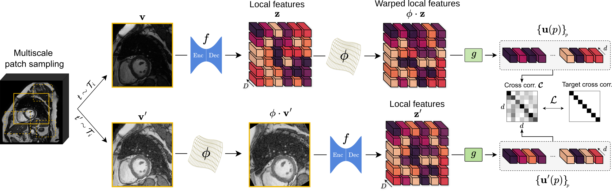

## Pix2Rep-v2: Data-Efficient Representation Learning for Dense Medical Imaging Applications

Official implementation of Pix2Rep-v2, a dense Self-Supervised Learning (SSL) method to solve dense medical imaging tasks in few-shot.

Accepted at MICCAI 2026! 🚀

## Abstract

> Dense self-supervised learning (SSL) is a powerful paradigm for learning without annotations the local descriptors required to solve dense medical imaging tasks. We present Pix2Rep-v2, a framework for SSL of pixel- and voxel-level representations suitable for few-shot downstream applications. Pix2Rep-v2 addresses the main challenges of dense SSL by leveraging a redundancy reduction objective at the pixel-level with a principle of equivariance of dense representations, that scales efficiently to 3D or wide field-of-view applications. We evaluate our method on four datasets, across multiple tasks, multiple modalities and anatomical structures using multiple backbones in 2D and 3D, and under various data regimes. As an alternative to linear probing or full fine-tuning on the downstream task, we also propose an in-context variant, without downstream training, based on a dense prototype approach. Pix2Rep-v2 shows substantially higher data-efficiency in few-shot scenarios compared to fully supervised baselines, and is competitive with the state-of-the-art e.g., +9.3 Dice points in 1-shot segmentation on the M&Ms-2 dataset.

<p align="center">
  
</p>

<p align="center">
  <em>Overview of the proposed Pix2Rep-v2 framework.</em>
</p>

## Getting Started

The project has been tested on **Linux environments (including HPC clusters)** and **macOS**.  
However, **running the code locally on macOS with Apple Silicon (MPS backend) is currently not supported** due to missing GPU dependencies (notably `faiss-gpu`). For full functionality, we recommend using a **Linux machine with CUDA support**.

#### Step 1: Create and activate the Conda environment

Create a new conda environment named `pix2repv2` with Python **3.12.11**, then activate it:

```bash
conda create -n pix2repv2 python=3.12.11
conda activate pix2repv2
````

#### Step 2: Install faiss-gpu

```bash
conda install -c pytorch -c nvidia -c conda-forge faiss-gpu=1.13.2
````

#### Step 3: 

Install PyTorch following the official installation guide depending on your hardware configuration (https://pytorch.org/get-started/locally/).
We recommend PyTorch 2.8.0 when compatible with your system.

Example installation for CUDA 12.6:

```bash
pip install torch==2.8.0 torchvision==0.23.0 --index-url https://download.pytorch.org/whl/cu126
````

#### Step 4: 

Finally, install the remaining Python dependencies:

```bash
cd Pix2Rep-v2
pip install -r requirements.txt
````

Now, you should be good to go!

## Pretraining Pix2Rep-v2 for cardiac applications

To pretrain Pix2Rep-v2 on the cardiac datasets (ACDC, MnMs, MnMs2), run:

```python
python -m scripts.cardiac.pretrain_pix2repv2 --pretraining_dataset all --exp_name {put_your_experiment_name}
```

Note that our framework relies on Hydra-based config files. For the script to run correctly, all .yaml configuration files must be located in the root directory under the ```config/``` folder.

If you want to override some hyperparameters (or try new ones!), or change backbone (unet or swin_unetr), add the following arguments to the previous command: 

```python
python -m scripts.cardiac.pretrain_pix2repv2 --pretraining_dataset all --exp_name {put_your_experiment_name} --overrides data.batch_size_pretraining={your_favorite_batch_size} pretraining.lr_backbone={your_favorite_LR} pretraining/backbone=unet 
```
You will find all the default configurations below (cf. **Hyperparameters configuration section**) and in the `config/` files.

## Finetuning Pix2Rep-v2 for cardiac structures segmentation

You can finetune Pix2Rep-v2 separately on three cardiac datasets ACDC, M&Ms and M&Ms-2. You can either start from our pretrained models (Pix2Rep-v2+U-Net or Pix2Rep-v2+SwinUNETR), or pretrain Pix2Rep-v2 yourself and use these pre-trained weights for fine-tuning.

```python
python -m scripts.cardiac.finetune_pix2repv2 --pretraining_dataset MnMs2 --exp_name {put_your_experiment_name} --backbone_name {name_of_the_pretrained_backbone}
```

## In-context segmentation with Pix2Rep-v2

You can perform in-context segmentation with Pix2Rep-v2 on cardiac applications. The only things you need are a pretrained Pix2Rep-v2 model (we will provide Pix2Repv2+UNet and Pix2Repv2+SwinUNETR models) and a support dataset {ACDC, MnMs or MnMs2}. You also need to specify $|X_s|$, i.e., the percentage of patients to include in the support set (in the following example, we use $|X_s|=1\%$ for the MnMs2 dataset):

```python
python -m scripts.cardiac.incontext --exp_name {put_your_experiment_name} --support_dataset MnMs2 --backbone_name {pretrained_backbone_to_load} --overrides finetuning.num_patients=1
```

NB: If you want to use the in-context downstream segmentation task with a pretrained Pix2Rep-v2+SwinUNETR, don't forget to change the default backbone in the CLI (`--overrides pretraining/backbone=swin_unetr`).

## Hyperparameters Configuration

We provide the complete hyperparameters configuration. For details on data augmentations parameters, please take a look at the config files (`pretraining.yaml` and `finetuning.yaml`).

### 2D Cardiac MRI Applications

| Phase | Hyperparameter | Value |
|---|---|---|
| **PRETRAINING** |  |  |
|  | Batch size | 48 |
|  | Epochs | 200 |
|  | Learning rate | 5e-4 |
|  | $\lambda_{barlow}$ | 5e-3 |
|  | Embedding dimension ($D$) | 1024 |
|  | Projector dimension ($d$) | 256 |
|  | Min. patch size factor | 0.33 |
|  | Max. patch size factor | 0.75 |
|  | Max. rotation angle | π/2 |
|  | Max. crop factor | 0.33 |
| **FINETUNING** |  |  |
|  | Batch size | 16 |
|  | Epochs | 100 |
|  | Patch size $(h, w)$ | (128, 128) |
|  | Spacing $(s_h, s_w)$ mm | (1.0, 1.0) |
|  | LR backbone | 5e-5 |
|  | LR outconv | 1e-2 |
|  | LR outconv (linear-probing) | 7.6e-3 |
|  | Loss | DiceCELoss ($\lambda_{dice}$ = $\lambda_{dice}$ = 1.0) |

---

### 3D Abdominal CT Applications

| Phase | Hyperparameter | Value |
|---|---|---|
| **PRETRAINING** |  |  |
|  | Batch size | 8 |
|  | Epochs | 200 |
|  | Learning rate | 1e-4 |
|  | $\lambda_{barlow}$ | 5e-3 |
|  | Embedding dimension ($D$) | 256 |
|  | Projector dimension ($d$) | 128 |
|  | Min. patch size factor | 0.7 |
|  | Max. patch size factor | 0.9 |
|  | Max. rotation angle | π/6 |
|  | Max. crop factor | 0.33 |
| **FINETUNING** |  |  |
|  | Batch size | 3 |
|  | Epochs | 1000 |
|  | Patch size $(h, w, d)$ | (192, 192, 64) |
|  | Spacing $(s_h, s_w, s_d)$ mm | (0.69, 0.69, 2.0) |
|  | LR backbone | 1e-5 |
|  | LR outconv | 1e-3 |
|  | Loss | DiceCELoss ($\lambda_{dice}$ = $\lambda_{dice}$ = 1.0) |

## SLURM jobs

TODO

## Data

All datasets are publicly available online. We will provide instructions about download links and split files after the review.

## Citing

For citing this work, please use the following BibTeX entry:

```bibtex
@InProceedings{Sifaoui_2026_MICCAI,
    author    = {Sifaoui, Sofiane and Angelini, Elsa and Toupin, Solenn and Pezel, Théo and Le Folgoc, Loïc},
    title     = {Pix2Rep-v2: Data-Efficient Representation Learning for Dense Medical Imaging Applications},
    booktitle = {International Conference on Medical Image Computing and Computer Assisted Intervention (MICCAI)},
    year      = {2026}
}
```